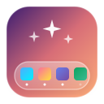

<p align="center">
  
</p>

<h1 align="center">DockCraft</h1>

<p align="center">
  <strong>O personalizador nativo e definitivo para o Dock do Ubuntu.</strong><br>
  Transforme a estética, ergonomia e usabilidade do seu ambiente de trabalho com elegância e alta performance.
</p>

<p align="center">
  
  
  
  
  
  
  
</p>

---

> **Design Responsivo com `Adw.Breakpoint`**: Em telas amplas, um simulador interativo do seu desktop fica fixo à esquerda enquanto você ajusta opções à direita. Em janelas menores ou tela dividida, a interface transiciona suavemente para o topo em formato recolhível, mantendo o fluxo de trabalho imperturbado.

---

## 💡 Por que o DockCraft?

O Ubuntu vem por padrão com uma barra lateral eficiente, mas engessada. Usuários que buscam uma experiência moderna — como a ilha flutuante do **macOS**, a barra corporativa centralizada do **Windows 11** ou a agilidade de docks minimalistas — frequentemente precisam recorrer a scripts frágeis de terminal ou dezenas de extensões conflitantes.

O **DockCraft** foi projetado do zero como uma aplicação **desktop nativa de primeira classe**, seguindo fielmente as diretrizes do **GNOME Human Interface Guidelines (HIG)**:
* ⚡ **Sem daemons em segundo plano**: Não consome memória em background; todas as configurações comunicam-se de forma atômica e segura com o backend nativo `GSettings` (`org.gnome.shell.extensions.dash-to-dock`).
* 🛡️ **Salvaguardas de Compatibilidade com GNOME 46 & Wayland**: Protege o sistema contra exceções upstream conhecidas do Clutter 46 e garante mapeamento determinístico de janelas no Wayland via `GLib.set_prgname`.
* 🔄 **Bidirecionalidade em Tempo Real**: Altere configurações pelo DockCraft ou pelas preferências nativas do Ubuntu; a interface sincroniza instantaneamente.

---

## 🌟 Funcionalidades

### 1. 🚀 Estilos Prontos em 1-Clique (Presets)
Transforme completamente a identidade visual do dock sem esforço:
* 🍎 **macOS Cupertino**: Barra estilo ilha flutuante na base da tela, cantos arredondados generosos, ícones centralizados, lixeira integrada e clique para minimizar.
* 🪟 **Windows 11 Modern**: Painel centralizado na base, indicadores retos no estilo barra horizontal, visual limpo corporativo e comportamento ágil.
* 🐧 **Ubuntu Unity Clássico**: Barra lateral esquerda de altura total, ícones clássicos de 48px e botão "Mostrar Aplicativos" fixado no topo.
* 🥷 **Minimalist Stealth**: Dock ultracompacto (34px), alta transparência e auto-ocultamento inteligente (*intellihide*).
* 🔄 **Padrão Ubuntu Original**: Botão de restauração com 1 clique para retornar às definições de fábrica do sistema com total segurança.
* 💾 **Criador de Presets Personalizados**: Salve suas combinações favoritas de cores, tamanhos e comportamentos com nome customizado.

### 2. 🎭 Galeria de Temas Curados
Paletas visuais desenhadas à mão com pré-visualização de amostras duplas de cor (fundo e marcador):

| Tema | Cor de Fundo | Cor do Indicador | Estilo Visual |
| :--- | :--- | :--- | :--- |
| **Dracula Dark** | `#282a36` (Roxo Noturno) | `#ff79c6` (Rosa Neon) | Pontos (`DOTS`) |
| **Cyberpunk Neon** | `#0a0f1d` (Azul Profundo) | `#00f2fe` (Ciano Elétrico) | Barras Retas (`DASHES`) |
| **Nord Arctic** | `#2e3440` (Cinza Ártico) | `#88c0d0` (Azul Glacial) | Pontos (`DOTS`) |
| **Tokyo Night** | `#1a1b26` (Índigo Tóquio) | `#bb9af7` (Lilás Violeta) | Barras Retas (`DASHES`) |
| **Gruvbox Retro** | `#282828` (Carvão Quente) | `#fabd2f` (Dourado Retrô) | Pontos (`DOTS`) |
| **Ubuntu Yaru** | `#2c001e` (Beringela Oficial) | `#e95420` (Laranja Ubuntu) | Pontos (`DOTS`) |
| **Vidro Fosco (Glass)** | `#ffffff` (28% Translucidez) | `#3584e4` (Azul Safira) | Pontos (`DOTS`) |
| **OLED Pure Black** | `#000000` (Preto Absoluto) | `#2ec27e` (Verde Esmeralda) | Barras Retas (`DASHES`) |

### 3. 🎨 Aparência & Design Granular
* **Posicionamento**: Base (Inferior), Lateral Esquerda, Lateral Direita ou Topo.
* **Modo Ilha Flutuante (Floating Pill Dock)**: Desative a barra de ponta a ponta e tenha um dock com cantos arredondados flutuando sobre o papel de parede.
* **Centralização de Ícones**: Alinhamento geométrico no centro da tela (`always-center-icons`).
* **Dimensão Precisa**: Slider contínuo de tamanho dos ícones de 16px até 96px com feedback em tempo real.
* **Transparência Customizada**: Modos Padrão, Fixo e Dinâmico, com seletor nativo de cor hexadecimal e slider de opacidade de 0% a 100%.
* **Estilos de Marcador de Apps Abertos**: Pontos, Traços/Barras, Quadrados, Segmentado ou Ciliora, com suporte a extração dinâmica da cor dominante do ícone.
* **Itens Especiais**: Alternadores independentes para exibir/ocultar a Lixeira, Dispositivos Montados (pendrives/HDs) e o botão "Mostrar Aplicativos".

### 4. ⚡ Usabilidade & Produtividade
* **Clique para Minimizar**: Clique no ícone de uma aplicação aberta para minimizá-la ou restaurá-la suavemente.
* **Ações com Scroll do Mouse**: Role a roda do mouse sobre qualquer ícone para alternar entre janelas abertas ou navegar entre áreas de trabalho virtuais.
* **Auto-Ocultamento Inteligente (Intellihide)**: O dock permanece visível e só se recolhe automaticamente quando uma janela ocupa o seu espaço.
* **Isolamento de Monitores e Workspaces**: Limite o dock a exibir apenas as janelas presentes na tela ou na área de trabalho em foco.

---

## 🛠️ Arquitetura e Engenharia de Software

O DockCraft foi estruturado com foco em manutenibilidade, separação de conceitos e robustez:

```
dock-craft/
├── bin/
│   └── dockcraft            # Executável de entrada principal
├── data/
│   ├── icons/               # Ícone SVG escalável do aplicativo
│   └── screenshots/         # Capturas de tela para documentação
├── presets/                 # Presets embutidos (JSON schema-driven)
│   ├── macos.json
│   ├── windows11.json
│   ├── unity.json
│   ├── minimalist.json
│   └── ubuntu_default.json
├── src/
│   ├── backend.py           # Wrapper seguro de baixo nível para Gio.Settings
│   ├── preset_manager.py    # Algoritmo de scoring e persistência de perfis
│   ├── theme_manager.py     # Registro e sincronização de temas e cores
│   ├── main.py              # Ciclo de vida Adw.Application e identidade Wayland
│   └── ui/
│       ├── window.py        # Janela com Adw.Breakpoint responsivo adaptativo
│       ├── dock_preview.py  # Simulador interativo do dock com ícones reais
│       ├── page_presets.py  # Gerenciamento de presets e ações rápidas
│       ├── page_themes.py   # Galeria visual de temas curados
│       ├── page_appearance.py# Ajustes granulares de estética e cor
│       └── page_behavior.py # Ajustes de ergonomia e produtividade
├── tests/                   # Suíte de testes unitários automatizados
├── install.sh               # Instalador com integração ao menu de aplicativos
├── uninstall.sh             # Desinstalador limpo
└── README.md
```

### Destaques Técnicos:
1. **Algoritmo de Identificação Única de Presets Ativos**:
   Em vez de comparações parciais que poderiam ativar múltiplos badges, o `PresetManager` utiliza um sistema de pontuação diferencial multichaves (`dock-position`, `extend-height`, `always-center-icons`, `dash-max-icon-size`, `autohide`, etc.), garantindo que **apenas um único preset legítimo seja exibido como ativo**.
2. **Eliminação de Duplo Scroll**:
   Integração nativa com `Adw.PreferencesPage` que já provê container de rolagem acelerado por hardware, eliminando travamentos de mouse e barras de rolagem duplicadas.
3. **Resiliência a Erros Upstream**:
   O backend intercepta valores problemáticos em tempo de execução (como propriedades obsoletas do Clutter 46) e aplica *fallbacks* transparentes para evitar que o dock do sistema quebre ou desapareça.

---

## 🚀 Como Executar e Instalar

### Pré-requisitos (Ubuntu 24.04 LTS / GNOME 46+)
Certifique-se de que as dependências do Python e GTK4 estão instaladas:
```bash
sudo apt update
sudo apt install -y python3 python3-gi gir1.2-gtk-4.0 gir1.2-adw-1
```

### Execução Imediata (Sem Instalação):
```bash
git clone https://github.com/drianodev/dock-craft.git
cd dock-craft
./bin/dockcraft
```

### Instalação no Sistema:
Para integrar o DockCraft nativamente ao lançador de aplicativos do Ubuntu:
```bash
./install.sh
```
Após executar, pesquise por **"DockCraft"** no menu *Mostrar Aplicativos* ou pelo atalho `Super`.

### Desinstalação:
```bash
./uninstall.sh
```

---

## 🧪 Qualidade de Código & Testes

O projeto conta com suíte de testes unitários cobrindo o backend GSettings, gerenciamento de presets, validação de tipos e inicialização da interface:

```bash
python3 -m unittest discover -s tests -v
```

```text
test_apply_and_retrieve_settings (test_backend.TestDockBackend) ... ok
test_preset_manager_builtin_loading (test_presets.TestPresetManager) ... ok
test_preset_save_and_delete (test_presets.TestPresetManager) ... ok
test_ui_window_initialization (test_ui_init.TestUIInitialization) ... ok
...
Ran 13 tests in 0.092s — OK
```

---

## 👤 Autor

Desenvolvido com foco em excelência e usabilidade por **Adriano Mendes**:
- **GitHub**: [@drianodev](https://github.com/drianodev)
- **Email**: [adrianomendes661@gmail.com](mailto:adrianomendes661@gmail.com)

---

## 📄 Licença

Este projeto é software livre distribuído sob os termos da licença [MIT](LICENSE).
